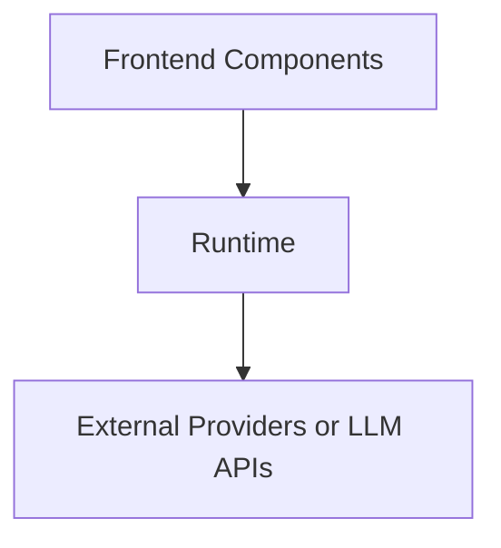
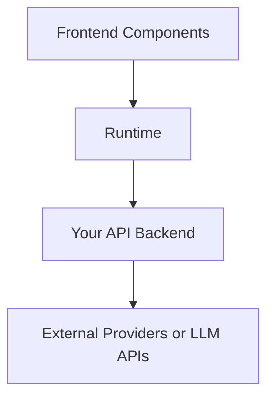
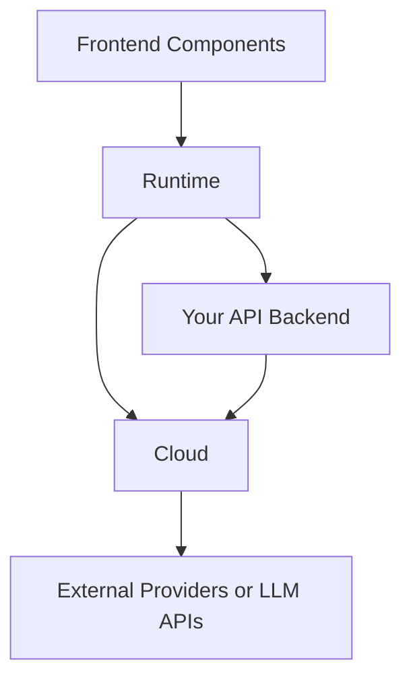

# Architecture
URL: /docs/architecture

How components, runtimes, and cloud services fit together.

> For AI agents: a documentation index is available at [llms.txt](/llms.txt). Use `.md` for canonical markdown pages; `.mdx` is kept as a backwards-compatible alias on supported URL paths.

## assistant-ui is built on these main pillars:

- 1\. Frontend components — Shadcn UI chat components with built-in state management

- 2\. Runtime — State management layer connecting UI to LLMs and backend services

- 3\. Assistant Cloud — Hosted service for thread persistence, history, and user management

### 1. Frontend components

Styled chat components built on top of shadcn/ui components. They read their state from the assistant-ui runtime provider. [View our components](/elements/thread)

### 2. Runtime

A React state management context for assistant chat. The runtime handles data conversions between the local state and calls to backends and LLMs. Runtimes are available for frameworks like Vercel AI SDK, LangGraph, and LangChain, along with a local runtime and an ExternalStore runtime for when you need full control of the frontend message state. [You can view the runtimes we support](/docs/runtimes/pick-a-runtime)

### 3. Assistant Cloud

A hosted service for thread management and message history. Assistant Cloud stores complete message history, automatically persists threads, supports human-in-the-loop workflows, and integrates with common auth providers so users can resume conversations at any point. [Cloud Docs](/docs/cloud)

## What each layer owns

Before picking a runtime or wiring components, it helps to see which layer owns which responsibility. assistant-ui draws hard lines between rendering, conversation state, and where the model actually runs.

### UI layer

Primitives and prebuilt components render the assistant experience: thread, messages, composer, message parts, actions, attachments, suggestions. They read and write through the runtime context, not directly against the backend or model.

### Runtime layer

The state and behavior boundary between UI and backend. The runtime owns or adapts conversation state: messages, thread state, composer state, run lifecycle, branching, editing, regeneration. Different runtimes exist because different backends own this state differently. `LocalRuntime` keeps state internal; `ExternalStoreRuntime` delegates to your store.

### Backend / agent layer

Produces assistant output and app-specific behavior. Depending on the runtime and protocol, the backend may emit text, message parts, tool calls, metadata, agent state, attachments, or other events that the runtime maps into UI state.

### Integration / protocol layer

Runtime adapters and protocols bridge assistant-ui to different backend shapes: AI SDK, LangGraph, LangChain, ADK, A2A, AG-UI, OpenCode, or your own. The DataStream and AssistantTransport protocols let a generic backend talk to assistant-ui without a custom adapter per app.

### Persistence layer

Thread and message history can be stored by Assistant Cloud or by your own database via thread and history adapters. Persistence is separate from rendering and backend generation, though the runtime coordinates with it.

## There are three common ways to architect your assistant-ui application:

#### **1. Direct Integration with External Providers**

#### **2. Using your own API endpoint**

#### **3. With Assistant Cloud**

## Going deeper

These pages go one level deeper on runtime internals, adapters, and persistence.

- [Runtime architecture](/docs/runtimes/concepts/architecture) — Core runtimes, protocol layers, framework adapters, and what each layer owns.
- [Adapters](/docs/runtimes/concepts/adapters) — Attachments, speech, feedback, history, suggestions across runtimes.
- [Threads](/docs/runtimes/concepts/threads) — Multi-thread support: cloud, custom database, ExternalStore.